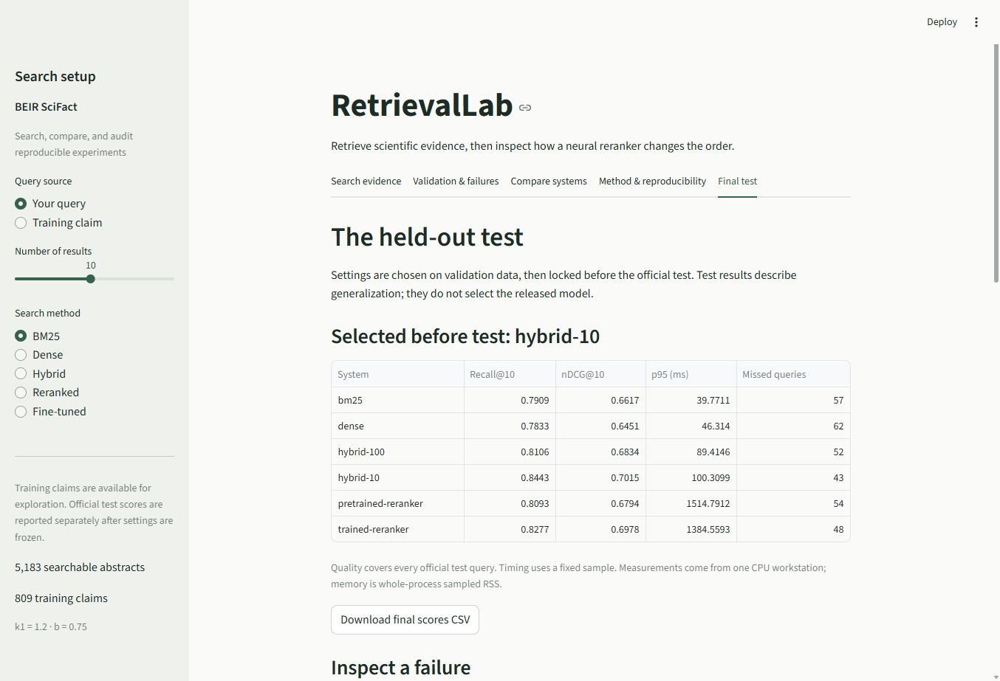

# RetrievalLab

An ML search and ranking evaluation platform, built one reproducible milestone at a time for summer 2027 internship applications.

**RetrievalLab 1.0:** search official BEIR SciFact with BM25, pinned MiniLM/FAISS dense retrieval, reciprocal rank fusion, and pretrained or experimentally fine-tuned TinyBERT reranking. FastAPI and Streamlit share the retrieval core. Explore rankings, inspect failures, compare measured quality/latency/memory, and export tables and figures. Every experiment records data, configuration, model, source hashes, seeds, splits, and package versions. Everything runs locally on a CPU, without accounts, database servers, or paid APIs.

Start with [the architecture guide](docs/ARCHITECTURE.md). Milestones [6: API and exports](docs/MILESTONE_6.md), [7: controlled fine-tuning](docs/MILESTONE_7.md), and [8: frozen official test](docs/MILESTONE_8.md) explain the final stages. Read [the model/data card](docs/MODEL_CARD.md) and [actual held-out results](docs/results/OFFICIAL_TEST_V1.md), including negative findings and execution limits. Earlier scores below are historical **development validation** results.

For one place to run the complete project, use [the local runbook](docs/RUNBOOK.md). For presenting it in an interview, use [the three-minute demo](docs/DEMO.md). [Release verification](docs/VERIFICATION_RELEASE.md) distinguishes executed checks from authored instructions and untested deployment claims.

For the complete Windows CPU reference environment, install `requirements-release.lock.txt`, then install this package with `--no-deps --no-build-isolation -e .`. Launch the API with `python -m uvicorn retrieval_lab.api:app --host 127.0.0.1 --port 8000 --workers 1` and open <http://127.0.0.1:8000/docs>. Launch Streamlit with the existing quick-start command. Models and data are prepared separately; installation does not run training or benchmark evaluation.



The historical BM25 baseline on 162 train-derived validation queries has Recall@10 **0.8013**, nDCG@10 **0.6673**. These are not official SciFact test scores. See [the baseline report](docs/results/BM25_VALIDATION_V1.md). For dense setup, concepts and comparisons, start with [the milestone 3 walkthrough](docs/MILESTONE_3.md).

Milestone 3 dense results: Recall@10 **0.8118**, nDCG@10 **0.6482**. Recall rose slightly while ranking quality fell; paired uncertainty intervals cross zero. Both methods reproduced byte-identical rankings. Read [the actual comparison and failure cases](docs/results/DENSE_COMPARISON_V1.md), including timings, memory and truncation limits.

Milestone 4 primary hybrid results: Recall@10 **0.8381**, nDCG@10 **0.7132**. The declared depth-10 ablation scored **0.8664 / 0.7291**. All four methods/settings reproduced byte-identical rankings; these are development scores. Read [the hybrid comparison](docs/results/HYBRID_COMPARISON_V1.md) for paired uncertainty, candidate coverage, timing variability and a real fusion regression.

Milestone 5's fixed TinyBERT reranker scored **0.8190 / 0.7033** versus the primary hybrid's **0.8381 / 0.7132**, with greater CPU cost. All paired quality intervals cross zero; this small pretrained stage did not improve the hybrid's point scores. All eight new runs reproduced byte-identical quality artifacts. Read [the measured reranking tradeoffs](docs/results/RERANKING_COMPARISON_V1.md), including full 162-query quality, the distinct 32-query timing profile, candidate ceilings and regressions.

## Official held-out results

All six systems were evaluated on all 300 official SciFact test queries after settings were frozen. The configuration selected on validation was **hybrid-10**: **Recall@10 0.8443**, **nDCG@10 0.7015**. Fine-tuning raised the reranker's nDCG from **0.6794 to 0.6978**, with substantially higher CPU latency than the hybrid. See [the complete results, uncertainty intervals, failure analysis and official split-overlap audit](docs/results/OFFICIAL_TEST_V1.md).

**What is in this repository:** source, tests, dashboard screenshots, exact configurations and versioned experiment evidence. Large model files, raw data, dense indexes and the virtual environment are not committed. Download the pinned pretrained models using the setup commands. To regenerate a trained checkpoint, follow [milestone 7](docs/MILESTONE_7.md); its recorded configuration refers to the original checkpoint hash. A new training study must keep its own outputs and configuration rather than silently replace the frozen benchmark.

[](https://github.com/arisalhasan/RetrievalLab/actions/workflows/ci.yml)

## Quick start

Use **Python 3.12**. Run commands from the repository root (the folder containing this README). The initial install needs internet access. SciFact is about 3 MB compressed. Allow roughly 1 GB for the virtual environment and room for caches. BM25 itself fits on a normal student laptop.

Windows PowerShell, without changing the script execution policy:

```powershell
py -3.12 -m venv .venv
.\.venv\Scripts\python.exe -m pip install -r requirements.lock.txt
.\.venv\Scripts\python.exe -m pip install --no-deps --no-build-isolation -e .
.\.venv\Scripts\python.exe -m retrieval_lab.cli download
.\.venv\Scripts\python.exe -m retrieval_lab.cli verify-split
.\.venv\Scripts\python.exe -m pytest
.\.venv\Scripts\python.exe -m streamlit run app.py
```

macOS / Linux:

```bash
python3.12 -m venv .venv
.venv/bin/python -m pip install -r requirements.lock.txt
.venv/bin/python -m pip install --no-deps --no-build-isolation -e .
.venv/bin/python -m retrieval_lab.cli download
.venv/bin/python -m retrieval_lab.cli verify-split
.venv/bin/python -m pytest
.venv/bin/python -m streamlit run app.py
```

Open [the local dashboard](http://localhost:8501). Windows Python 3.12 is the reference environment; see [verification notes](docs/VERIFICATION.md) for what actually ran. The lock pins runtime, testing, and build packages. macOS/Linux commands are provided but must be verified on those platforms. For a fresh dependency resolution instead of the reference environment, use `python -m pip install -e ".[dev]"`; this may select different transitive versions.

Enter `cell division and mitosis` and select **Search**. Or choose **Training claim** in the sidebar to explore official train claims and available judgments. Use **Read full abstract** to inspect a document and **Download this search** to save the query, config, file hashes, timing, and ranking. The index is cached in memory; changed data or settings rebuild it.

## Add dense search (milestone 3)

After base setup, Windows Python 3.12 users can install the CPU reference stack and prepare the model:

```powershell
.\.venv\Scripts\python.exe -m pip install -r requirements-dense.lock.txt
.\.venv\Scripts\python.exe -m pip install --no-deps --no-build-isolation -e ".[dev,dense]"
.\.venv\Scripts\python.exe -m retrieval_lab.cli model-download
.\.venv\Scripts\python.exe -m retrieval_lab.cli build-dense
.\.venv\Scripts\python.exe scripts/run_milestone3.py --name student-m3-v1
```

Then select **Dense** in Streamlit or open **Compare systems** and compare the two saved runs. Embedding weights download once (about 91 MB); document encoding is also prepared once and cached. Every search still encodes its query. Allow several GB for the optional CPU stack. The [milestone 3 guide](docs/MILESTONE_3.md) explains the math, cache, other-platform setup, reproducible experiment commands and interview checkpoint.

## Add hybrid search (milestone 4)

Hybrid search adds no dependencies beyond the dense setup. Select **Hybrid** in Streamlit and open **Why this rank?** to inspect each method's rank contribution. It uses equal-weight RRF with constant 60 and up to 100 candidates per source. Complete component settings are embedded in `configs/hybrid.json`.

```powershell
.\.venv\Scripts\python.exe scripts/run_milestone4.py --name student-m4 --repeat --depth-ablation 10
```

This snapshots settings, runs fresh BM25/dense/hybrid experiments and their reproductions, adds the declared depth-10 ablation, and writes paired comparisons. Use a new name each time. Read [the milestone 4 walkthrough](docs/MILESTONE_4.md) for the rank-fusion math, candidate versus final recall, timing scope, testing and interview questions.

## Add pretrained reranking (milestone 5)

The small pretrained TinyBERT model reads a query and each of the top 50 hybrid candidates jointly. It reorders that bounded set, records raw logits and rank movements, and requires no new Python dependencies or training.

```powershell
.\.venv\Scripts\python.exe -m retrieval_lab.cli reranker-download
.\.venv\Scripts\python.exe scripts/run_milestone5.py --name student-m5 --repeat
```

Select **Reranked** in Streamlit. The new weights download is about 18 MB. Quality still evaluates all 162 validation queries; the declared CPU timing profile uses the same fixed 32-query sample for every method, five measured passes (160 calls). This differs from the historical 810-call profile, so keep the timings separate. Read [the milestone 5 guide](docs/MILESTONE_5.md) for the model pin, compute scope, candidate ceilings, joint truncation, tests and interview questions.

## Reproduce a single-query run

After setup, substitute your virtual environment's Python for `python` below:

```bash
python -m retrieval_lab.cli search --query "cell division and mitosis" --top-k 10 --output runs/bm25-smoke-001.json
python -m pytest
python -m ruff check .
python -m ruff format --check .
```

The record contains the actual ranking and timing, config, implementation/tokenizer versions, seed, split, data/source hashes, Python/platform, and Git state where available. Use a new output filename each time; existing records cannot be overwritten. This single-query smoke run is **not a benchmark**. Its cold query time is not a latency percentile or accuracy metric. No search command reads test judgments.

## Run the validation experiment

The committed split manifest contains **647 training and 162 validation queries** derived from the 809 official train queries. Claims sharing positive evidence or token-set Jaccard similarity of at least 0.8 are kept in the same connected group. Seed: 42. The official test set is not part of this split.

```bash
python -m retrieval_lab.cli verify-split
python -m retrieval_lab.cli evaluate --output runs/my-bm25-validation-001
```

Choose a new output directory each time. The runner verifies the saved split, builds BM25, warms up all validation queries once, and measures five shuffled passes (810 calls). It saves `manifest.json`, `split.json`, `queries.json`, `timings.csv`, and `report.md`. Metrics are independently checked with the `pytrec_eval` backend used by BEIR, supplied by the maintained Terrier distribution. The full neural BEIR package is not needed for these checks.

Reload Streamlit and open **Validation & failures**. Select the saved run, inspect the quality/speed measurements, and choose a query to compare its missed judged evidence with the retrieved ranking. The dashboard verifies data and artifact fingerprints before showing a report. A summary export is available. Timing runs execute in the CLI to keep UI work out of the measured process.

The milestone ZIPs include saved experiment evidence; benchmark corpus and model files download separately. Source-only checkouts may have no saved runs until you execute experiments. Set `RETRIEVALLAB_RUNS_DIR` to choose a different report directory.

To create a separate split for an explicitly new experiment, without replacing the committed one:

```bash
python -m retrieval_lab.cli split --seed 42 --validation-fraction 0.2 --output configs/splits/my-split-v1.json
```

Do not repeatedly change the split to seek a better score. Read [the milestone 2 walkthrough](docs/MILESTONE_2.md) and [execution record](docs/VERIFICATION_MILESTONE_2.md).

## Data and evaluation boundaries

- The dataset comes from [BEIR's official SciFact archive](https://github.com/beir-cellar/beir#beers-datasets), verified against its published MD5. A manifest also records SHA-256 hashes for the archive and each data file. MD5 identifies the published artifact; it is not a security guarantee.
- Official files are `corpus.jsonl`, `queries.jsonl`, `qrels/train.tsv`, and `qrels/test.tsv`. `qrels` means relevance judgments: query ID, document ID, integer grade. The loader understands BEIR's format without installing its full neural stack for milestone 1.
- SciFact has official **train and test**, with no official validation split. The UI and search command use **train**. Queries are filtered by the selected qrels, following [BEIR's data loader behavior](https://github.com/beir-cellar/beir/blob/main/beir/datasets/data_loader.py).
- All corpus documents are indexed. Sharing the searchable corpus is expected in retrieval; test labels must not influence model choices. The downloader hashes test bytes without inspecting their judgments.
- Use the committed train-derived split for model development and comparison. Its grouping is a leakage-reduction heuristic, not a guarantee of semantic/topic independence. See [the experiment policy](docs/EXPERIMENTS.md).
- A relevant abstract can **support or refute** a claim. Missing judgments do not establish irrelevance. BM25 scores are not probabilities or truth assessments.

Data and generated run outputs are ignored by Git. Check the dataset's source licensing before redistribution. The [SciFact source project](https://github.com/allenai/scifact) explains the original task.

## Repository layout

```text
RetrievalLab/
├── app.py                     Streamlit presentation and session state
├── configs/                   BM25/dense/evaluation settings and frozen split IDs
├── src/retrieval_lab/
│   ├── types.py               Document and SearchResult objects
│   ├── data.py                Explicit-split BEIR loader and validation
│   ├── download.py            Verified download and data manifest
│   ├── bm25.py                Tokenization, postings, scoring, stable top-k
│   ├── dense_config.py        Immutable model and inference settings
│   ├── model_store.py         Verified public model download and local assets
│   ├── encoders.py            Sentence Transformers / PyTorch CPU boundary
│   ├── dense.py               Versioned embeddings cache, fresh query encoding
│   ├── vectors.py             FAISS exact cosine search and NumPy oracle
│   ├── retrievers.py          Shared search interface and factory
│   ├── hybrid.py              Equal-weight RRF, configuration, rank contributions
│   ├── reranking.py           Bounded rerank configuration, ordering and trace
│   ├── cross_encoder.py       Local pretrained TinyBERT pair logits
│   ├── reranker_store.py      Checked reranker assets and revision
│   ├── rerank_diagnostics.py  Input ceilings, losses and saved-trace verification
│   ├── splits.py              Group-aware train/validation manifests
│   ├── metrics.py             Recall/nDCG and reference checks
│   ├── profiling.py           Process CPU/RSS and latency summaries
│   ├── provenance.py          Hardware, packages, Git state and code hashes
│   ├── evaluation.py          Timed experiments and immutable report artifacts
│   ├── comparison.py          Paired scores and group-bootstrap intervals
│   ├── dashboard.py           Saved-report viewer and failure analysis
│   └── cli.py                 Download, split, search and evaluation commands
├── tests/                     Unit, integration, Streamlit app tests
├── docs/                      Beginner guide, policy, roadmap, verification
├── data/                      Generated benchmark cache (ignored)
├── runs/                      Generated search records (ignored)
├── models/                    Pinned model files (generated, ignored)
├── indexes/                   Verified document embeddings (generated, ignored)
├── scripts/run_milestone3.py   Repeatable paired experiment
├── scripts/run_milestone4.py   Aligned three-method runs and depth ablation
├── scripts/run_milestone5.py   Aligned neural reranking and timing-profile runs
├── pyproject.toml             Package metadata and direct dependency pins
├── requirements.lock.txt      Lean base reference dependencies
└── requirements-dense.lock.txt Full Windows CPU reference environment
```

The final modules add `api.py`, `exports.py`, `training.py`, `release.py`, `final_report.py`, and `release_dashboard.py`; see [the architecture guide](docs/ARCHITECTURE.md) and [roadmap](docs/ROADMAP.md). Each of the eight milestone guides includes a local verification checkpoint and three interview questions. `requirements-release.lock.txt` pins the complete final Windows CPU environment; the older locks remain historical setup references. The GitHub Actions workflow runs offline unit/integration checks on Windows; see [Actions](https://github.com/arisalhasan/RetrievalLab/actions) for its current status. The historical local verification report records what was executed before publication.

## Tests

The default suite uses small, explicitly synthetic BEIR-shaped fixtures and never downloads data. It checks BM25/metric hand calculations, reference-metric agreement, split grouping/isolation, stable rankings, malformed inputs, cache/report integrity, CLI provenance, process measurements, and Streamlit behavior through [AppTest](https://docs.streamlit.io/develop/api-reference/app-testing/st.testing.v1.apptest).

Dense tests add FAISS/scikit-learn cosine agreement, cache invalidation/corruption checks, verified model transport and a synthetic-encoder experiment through the real shared evaluator/dashboard. Install dense dependencies to run those tests; native FAISS checks skip explicitly when unavailable. `RUN_DENSE_MODEL_TESTS=1` enables a local real-model check after model download. See [milestone 3](docs/MILESTONE_3.md) for commands and the exact distinction between synthetic tests and benchmark evidence.

Hybrid tests add an independent exact-rational RRF oracle, hand examples, tie/duplicate/empty cases, score-scale independence, live child calls, candidate-miss versus fusion-loss diagnostics, saved-report checks and UI contribution explanations. Synthetic vectors are never presented as benchmark results.

Reranking tests add candidate membership/bounds, raw-logit ordering, repeat inference, verified model files, rank movement, saved-trace checks and full quality coverage with a smaller timing sample. Set `RUN_RERANKER_MODEL_TESTS=1` after downloading TinyBERT to compare real wrapper scores with direct PyTorch logits. The default suite stays offline; the milestone 5 guide documents the opt-in checks.

Opt in to real SciFact train-data smoke checks after downloading:

```powershell
$env:RUN_SCIFACT_TESTS = '1'
.\.venv\Scripts\python.exe -m pytest
```

```bash
RUN_SCIFACT_TESTS=1 .venv/bin/python -m pytest
```

These additionally check official cache/counts, repeatable search, the saved split, and absence of shared positive evidence across partitions. They do not evaluate test labels. AppTest checks behavior, not browser appearance. Current checks are in [VERIFICATION_MILESTONE_2.md](docs/VERIFICATION_MILESTONE_2.md); [VERIFICATION.md](docs/VERIFICATION.md) preserves the milestone 1 record.

## Troubleshooting

- **Python opens the Microsoft Store:** install Python 3.12 and use `py -3.12` or the real interpreter path. The Windows alias may not be a working installation.
- **Import fails:** use the same virtual environment for installation, tests, and Streamlit. Run from the repository root.
- **Dataset missing:** run `python -m retrieval_lab.cli download`. For another location, use `download --data-root D:/datasets`, then set `RETRIEVALLAB_DATA_DIR` to `D:/datasets/scifact` for the UI or pass `search --data-dir D:/datasets/scifact`.
- **Corporate certificate blocks Python's download:** use your organization's trusted CA setup. On Windows, download through its trusted certificate store and verify the archive locally:

  ```powershell
  New-Item -ItemType Directory -Force data
  Invoke-WebRequest 'https://public.ukp.informatik.tu-darmstadt.de/thakur/BEIR/datasets/scifact.zip' -OutFile data/scifact.zip
  .\.venv\Scripts\python.exe -m retrieval_lab.cli download --archive data/scifact.zip
  ```

  The published checksum is still enforced. Do not disable certificate verification.
- **Checksum mismatch / partial cache:** the program refuses reuse. Restore the original data or download into a new `--data-root`; it does not erase existing files.
- **Port 8501 is busy:** add `--server.port 8502` to the Streamlit command.
- **No results:** try another word or spelling. BM25 requires shared tokens; semantic matching comes later.
