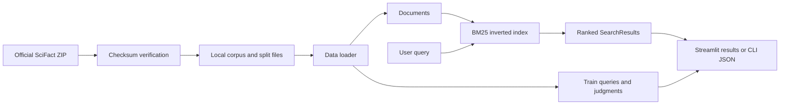
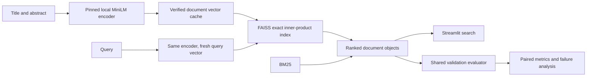
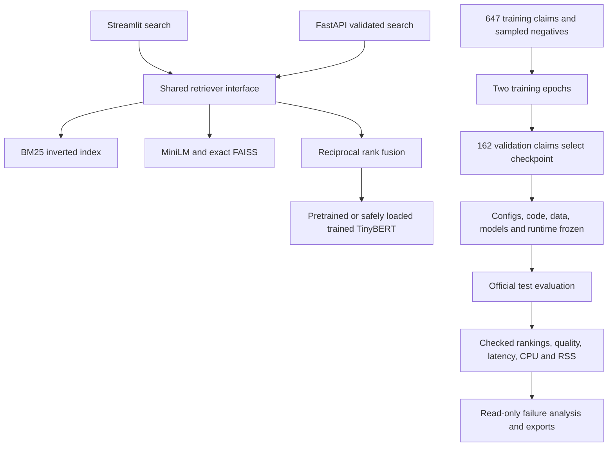

# How RetrievalLab works

Milestone 1 has three jobs: read documents correctly, rank them consistently, and make the ranking inspectable.



Judgments describe which documents are relevant to a known query. They never enter the BM25 index or its scoring function. The UI uses train judgments only to annotate an already-computed ranking.

## Reading order

1. `types.py`: two frozen dataclasses. A `Document` has an ID, title, and abstract. A `SearchResult` pairs a document with a score. Frozen objects avoid accidental edits while viewing results.
2. `data.py`: reads one JSON object per line, checks IDs and text, then reads one selected relevance file. It rejects duplicate IDs, unknown references, negative grades, and malformed files. The result contains all documents and only the selected split's queries/judgments.
3. `bm25.py`: converts text to tokens, builds an inverted index, and retrieves the highest scores. It accepts documents without labels, making that separation easy to test.
4. `download.py`: checks the official archive and copies only known members into a temporary directory before installing the complete cache. The manifest ties experiments to exact files.
5. `cli.py`: connects the pieces for repeatable command-line runs. It measures index construction and one query separately and records the environment.
6. `app.py`: gathers a query, calls the same index, and presents results. It caches by file hashes and config and ties displayed results to their query/settings, preventing stale rankings after input changes.

## An inverted index

Imagine a book's index. Instead of rereading every page to find “mitosis,” look up the word and find the pages containing it. Our index maps each token to `(document ID, term frequency)` pairs. A query touches matching postings instead of rescanning every abstract.

If document A contains “cells divide” and B contains “cells grow,” the posting for `cells` contains both, while `divide` contains only A.

Index construction is approximately linear in corpus tokens. Query work depends on postings visited, followed by top-k selection. Common words have long postings, so some queries cost more. Python object overhead is real; larger-scale performance and resource profiling come later.

## BM25, step by step

For query q and document d:

```text
score(q, d) = sum over unique query terms t:
  IDF(t) × [f(t,d) × (k1 + 1)] /
           [f(t,d) + k1 × (1 - b + b × |d| / avgdl)]

IDF(t) = ln(1 + (N - df(t) + 0.5) / (df(t) + 0.5))
```

- **N** is document count; **df(t)** counts documents containing t. Rare terms have higher inverse document frequency (IDF) because they distinguish documents better.
- **f(t,d)** counts occurrences in a document. Repetition helps, but its contribution saturates. Ten repeats should not be ten times as convincing as one.
- **|d|** and **avgdl** are this document's token count and the collection average.
- **k1 = 1.2** controls term-frequency saturation.
- **b = 0.75** controls length normalization. At b=0, length is ignored; at b=1, the full length ratio is used.

Ties break by string document ID ascending. Repeated query tokens count once. Unmatched queries return no documents rather than arbitrary zero-score results. These are explicit experiment choices, not universal BM25 conventions.

The tokenizer uses Unicode case-folding, letter/digit tokens, title plus abstract, no stemming, and no stopword removal. Hyphens and underscores split tokens (`IL-6` becomes `il`, `6`). Different libraries/analyzers produce different results; this baseline is not claimed to reproduce BEIR's Elasticsearch BM25 scores.

The positive-IDF expression and default k1/b match the conventions documented by [Apache Lucene's BM25Similarity](https://lucene.apache.org/core/9_12_1/core/org/apache/lucene/search/similarities/BM25Similarity.html). This does not imply matching its complete scoring/analyzer pipeline. The independent hand-calculation test checks our exact formula.

## Reproducibility

A seed alone is insufficient. BM25 uses no randomness here; its recorded seed is reserved for later models. Rankings depend on data contents, tokenizer, formula, parameters, ordering, and code. File hashes identify data; config identifies settings; Git identifies code when available; the dependency lock identifies the reference environment.

Latency varies across machines/process states even when rankings match. The UI times one search call, excluding loading, indexing, network, and rendering. Later experiments add warmups, repetitions, percentiles, hardware descriptions, and resource measurements.

BM25 and dense retrievers accept the same corpus and return the same document/score objects. Hybrid retrieval will combine their rankings. A reranker will reorder a bounded candidate list. FastAPI will expose the stable core later.

## Milestone 2: evaluate outside retrieval

`splits.py` groups official training claims, saves train/validation IDs, and verifies their provenance. It uses shared positive evidence and token-set similarity to reduce closely related claims appearing on opposite sides. The corpus still contains every searchable document. No official test judgments enter this process.

`metrics.py` scores an ordered ranking against judgments and checks its Recall/nDCG against a reference evaluator. `profiling.py` measures query latency and process CPU/RSS. `evaluation.py` coordinates these modules, saves immutable per-query evidence and timing samples, and generates a report. `provenance.py` records hardware, installed packages and code hashes.

`dashboard.py` reads verified saved reports. Experiments run in their own CLI process, so opening charts does not affect the measured search process. Changing the search query does not recompute a saved validation result. Data/manifest/artifact hashes prevent accidentally displaying an old run as if it used new data.

Read [the milestone 2 guide](MILESTONE_2.md) for metric examples and the student checkpoint. Saved reports include process-memory and timing caveats; a single headline number is not a complete performance claim.

## Milestone 3: neural encoding with a shared evaluator



`dense_config.py` defines model/settings; `model_store.py` verifies downloads. `encoders.py` owns PyTorch/Sentence Transformers inference. `dense.py` owns document-vector persistence and query encoding. `vectors.py` owns normalized vector checks, FAISS and an independent NumPy oracle. Heavy model imports are lazy, so BM25 does not require loading neural libraries.

`retrievers.py` supplies one search interface to `evaluation.py`. `comparison.py` validates identical splits, labels, metrics and evaluation settings before computing paired differences and group-bootstrap intervals. The dashboard reads saved evidence and exports comparisons; it never substitutes live UI search timings for benchmark measurements.

Document cache identity includes source/model/data/config/runtime fingerprints. Cached documents save repeated model work; queries are encoded for every timed call. Model inference uses local files only, without downloaded Python code. CPU library/model initialization and corpus encoding are recorded separately from warm-query timing. See [the milestone 3 walkthrough](MILESTONE_3.md) for formulas, exact-search costs, truncation, limitations and local setup.

## Milestone 4: fuse lists, then diagnose the candidate boundary

`hybrid.py` adds `HybridConfig`, the pure `fuse_rankings()` function and `HybridIndex`. The config contains full child settings, a rank constant and per-source depth. On every query, the hybrid calls BM25 and dense serially, then sums reciprocal rank contributions over the candidate union. A document missing from one list contributes zero from that source. No labels, raw-score calibration, result cache or neural training are involved.

The shared evaluator still measures the full live `search()` call. It checks the deeper dense candidate list with the NumPy oracle and scores the final ranking with the same Recall/nDCG reference backend. A separate untimed pass produces source/union candidate recall, documents missed by both candidate lists, documents lost below fused rank 10, and the source-rank/contribution trace. `load_report()` rebuilds the fusion from saved source ranks and recalculates candidate diagnostics before displaying a hybrid report.

The dashboard exposes live **Why this rank?** explanations and saved **Explain fusion and candidate misses** views. `scripts/run_milestone4.py` snapshots aligned component settings and runs standalone baselines, hybrid, repeats and an optional declared candidate-depth ablation. The existing BM25, encoder and vector implementation files remain unchanged, so their valid document cache can be reused. See [the milestone 4 guide](MILESTONE_4.md).

## Milestone 5: bound the expensive joint scorer

`RerankedIndex` in `reranking.py` asks the same hybrid for 50 candidates, passes query/title/abstract pairs to `CrossEncoderScorer`, then sorts their raw scalar logits. `cross_encoder.py` owns local Sentence Transformers/PyTorch inference. `reranker_store.py` verifies pinned TinyBERT assets using the existing bounded download transport; no retrieved Python or pickle weights are executed. Existing dense/BM25/RRF source modules and document cache identities stay unchanged.

`rerank_diagnostics.py` keeps labels outside retrieval and scoring. It checks actual rerank-input recall, before/after quality, relevant documents outside the input, and input documents lost below the final cutoff. Saved source ranks, candidate membership/logits and derived aggregates are reconstructed/checked before reports display. The UI shows rank movement, not a generated explanation of model reasoning.

For the declared milestone 5 CPU profile, `evaluation.py` scores all validation queries in an untimed quality pass, then warms/measures a fixed label-independent sample of 32 query IDs. Every timed search still executes the full live pipeline without pair-score caching. The evaluator can also retain the older all-query timing profile. The exact selected IDs/config are saved and checked, and comparisons reject different samples. See [the milestone 5 guide](MILESTONE_5.md).

## Milestones 6–8: serve, train, then freeze



`api.py` is a small transport layer with bounded input and one CPU request at a time. It lazily loads prepared local engines, never downloads assets or starts corpus encoding, and separates query inference from initialization. API errors distinguish invalid requests, busy inference, and unavailable assets. `exports.py` turns verified comparison records into CSV and matplotlib figures.

`training.py` prepares explicit train-only positive/assumed-negative pairs, runs deterministic CPU AdamW/BCE training, checks all validation metrics, and writes safe checkpoints. The original model is epoch 0 and may win selection. Checkpoint identity is its weight SHA-256; every tokenizer/config/model file is verified before loading. Retrieval still receives no relevance labels.

`release.py` verifies development reports and records a pre-test freeze. The explicit final command rejects changed runtime/source/config/data/model assets before opening test labels. It calls the same metric/timing engine using an explicitly marked official-test partition; development commands still reject test datasets. Each completed test result has a freeze identity. `final_report.py` produces shareable tables, paired comparisons and figures. `release_dashboard.py` reads verified final reports and shows missed evidence without retraining or rerunning benchmarks.

Read the milestone [6](MILESTONE_6.md), [7](MILESTONE_7.md), and [8](MILESTONE_8.md) guides for commands, code explanations, verification checkpoints and interview questions. The [model card](MODEL_CARD.md) explains intended use and limitations. This remains a focused local application: no database server, background job infrastructure, paid APIs, or public deployment is required.
