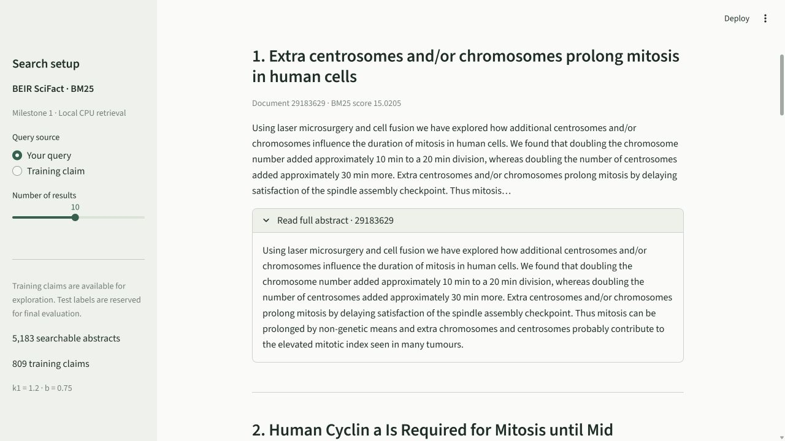
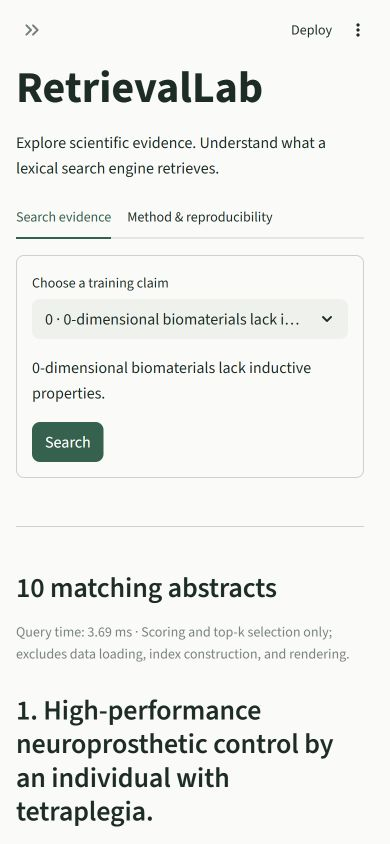

# Execution record

This preserves the milestone 1 record. See [the milestone 2 execution record](VERIFICATION_MILESTONE_2.md) for the current evaluation implementation and checks.

Executed on **7 November 2026**, using Python **3.12.14**, Windows 11 x86-64, RetrievalLab **0.1.0**, Streamlit **1.51.0**, pytest **8.4.2**, and Ruff **0.14.4**. Exact dependency/build versions are in `requirements.lock.txt`. This is an implementation verification record, not a benchmark report.

## Checks actually executed

| Check | Observed result |
| --- | --- |
| Official SciFact download | Passed published MD5 `5f7d1de60b170fc8027bb7898e2efca1`; installed 5,183 abstracts and 809 train queries |
| Archive SHA-256 | `536e14446a0ba56ed1398ab1055f39fe852686ecad24a6306c80c490fa8e0165` |
| Cache reuse | Reverified existing files successfully without a new download |
| Core smoke checks | Hand-calculated score, no-match behavior, official train loading, repeatable top-10 search passed |
| First default pytest run | **46 passed, 1 skipped**, 5.45 seconds; official-data check skipped as designed |
| Final suite with `RUN_SCIFACT_TESTS=1` | **47 passed**, 5.11 seconds; unit, data/search integration, download boundary, CLI, config, AppTest, and official train smoke checks |
| Ruff lint | `All checks passed!` |
| Ruff formatting | `15 files already formatted` |
| Dependency consistency | `No broken requirements found.` |
| Lock consistency | Offline dry-run found the recorded requirements installed in the reference environment |
| Documented editable installation | Passed `pip install --no-deps --no-build-isolation -e .` using the normal Windows profile |
| Package build | Built `retrievallab-0.1.0-py3-none-any.whl` without dependencies/network |
| CLI repeatability | Two separate saved runs had identical document IDs, titles, ranks and exact floating-point scores |
| Real browser search | Queried `cell division and mitosis`; top document ID `29183629`, title “Extra centrosomes and/or chromosomes prolong mitosis in human cells”; matched the CLI ranking |
| Browser no-match flow | `qzxqzxunknown` submitted with Enter displayed the expected no-match message |
| Browser training mode | Official training claim `0` loaded and searched; displayed available judgment status on results |
| Browser full abstract | Expanded the first mitosis result and verified the complete abstract was visible |
| Browser JSON download | Downloaded and parsed the export: train split, training query ID `0`, 10 result records |
| Narrow layout | Inspected 390 × 844 viewport with sidebar collapsed; page scroll width was 390 pixels, with readable wrapped text |
| Browser console | No error entries were observed; see the framework warning note below |
| Syntax compilation | `compileall` passed for source, app, and tests |

Actual local run records are `runs/bm25-smoke-001.json` and `runs/bm25-smoke-002.json`. The test summary is `runs/pytest-milestone1.txt`. Generated runs are ignored by Git and omitted from the portable source ZIP. No Recall@10/nDCG@10 or aggregate benchmark result was produced. Single-query timings are incidental smoke measurements with their scope stated in each record.

The train loader did not open test qrels. The downloader copied and hashed the test file for integrity without parsing its judgments. Synthetic fixtures were used only for automated tests.

## Environment issues and limits

- Python's direct HTTPS download failed certificate verification in the bundled runtime. The official ZIP was retrieved with Windows' trusted downloader, then accepted by the same archive checksum verification. Certificate verification was not disabled. The README includes this fallback; direct Python HTTPS downloading remains unverified in this environment.
- The first package install timed out during a download. Retrying with a longer timeout completed successfully.
- A restricted temporary Windows profile with braces in its path caused setuptools' editable-install variable expansion to fail. The same documented command succeeded under the normal Windows profile. This is an execution-environment limitation, not a passing check being inferred from a failed run.
- Live serving required normal local socket access. The verified server binds only `127.0.0.1`. An earlier restricted-context server attempt was stopped.
- Streamlit emitted browser warnings about empty optional sidebar color defaults (`widgetBackgroundColor`, `widgetBorderColor`, `skeletonBackgroundColor`). The inspected screens rendered correctly. No unsupported theme settings were added to suppress framework warnings.
- Git commit and dirty-state fields are `null` because usable project Git metadata was unavailable. No repository was initialized or commit created. Version source code in your own repository before reporting portfolio experiments.

## Not executed

- A second clean environment install from the lock file. The initial full dependency installation, lock consistency check, editable installation, and wheel build were executed; the lock was captured from that verified environment.
- macOS, Linux, Python 3.13, other browsers, physical mobile devices, or a full screen-reader/keyboard accessibility audit. The narrow viewport is a browser layout check, not a physical device test.
- Official test-set evaluation, benchmark metric validation against BEIR, latency distributions, resource-consumption experiments, dense/hybrid retrieval, neural reranking, fine-tuning, or FastAPI. These belong to later milestones.

## Captured views

