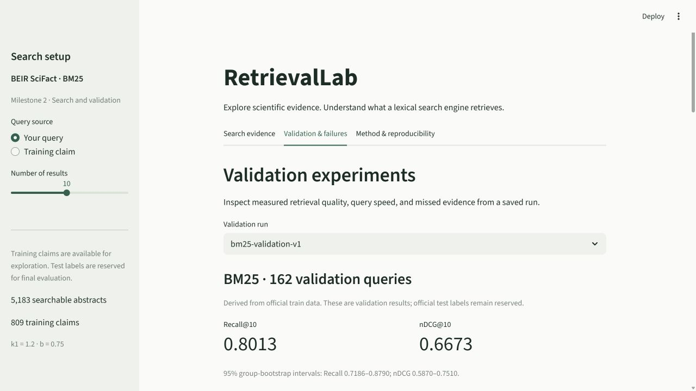

# Milestone 2 execution record

Executed on **7 November 2026**, Windows 11 x86-64, Python 3.12.14, RetrievalLab 0.2.0. The original [milestone 1 record](VERIFICATION.md) remains unchanged apart from its pointer to this document.

## Checks actually executed

| Check | Observed result |
| --- | --- |
| Pre-change baseline | 47 tests passed |
| Split unit checks | 9 passed: deterministic grouping, transitive relationships, coverage/disjointness, drift/tamper rejection, test-split rejection, invalid settings |
| Committed official train split | Verified 647 train / 162 validation, 490 groups, maximum group 8; zero shared positive-evidence documents |
| Metric hand calculations | Recall, discounted rank weighting, linear graded gain, cutoff, short/empty rankings, self IDs and no-positive queries passed |
| Reference metric edge checks | Passed against pytrec_eval/Terrier on short, empty, graded, zero-positive and self-ID cases |
| First official-data validation experiment | Completed 162 queries; 810 timed calls; every per-query metric agreed exactly with the reference evaluator |
| Reproduction experiment | Same quality and bootstrap intervals; byte-identical per-query rankings/scores/metrics file; every reference check passed |
| Code provenance | Both runs matched current BM25, metric, split, evaluation, profiling, provenance and CLI source hashes |
| Resource checks | Self-process RSS/CPU collected; sampler cleanup verified on normal completion and exceptions; percentile interpolation hand-checked |
| Run/report integrity | Existing outputs protected; altered artifact/aggregate rejected; entire synthetic experiment succeeded with deliberately unusable test judgments |
| Dashboard AppTest | Search regressions, report metrics/filter/ranking, missing-evidence abstract with zero search matches, and corrupted-report handling passed |
| Final suite, official-data checks enabled | **81 passed in 7.52 seconds**, no skips |
| Final focused UI checks before last failure-path test | 13 passed |
| Ruff | All checks passed; 25 Python files formatted |
| Dependencies | Free psutil 7.2.2, pytrec-eval-terrier 0.5.11 and its SciPy dependency installed; `pip check` found no broken requirements |
| Package installation | Editable 0.2.0 install completed with the normal Windows profile and explicit dashboard dependencies |
| Live desktop browser | Verified 162-query report, Recall/nDCG, intervals, p50/p95, failure table, query selector and missed-evidence document title |
| Live resources view | Expanded the resource section and observed the histogram; numeric bin-axis refinement was subsequently exercised through AppTest |
| Live summary export | Downloaded and parsed JSON; 162 queries, matching Recall/nDCG, reference check passed |
| Desktop preview | Saved `docs/assets/validation-desktop.jpg` from the actual browser |
| Failure token inspection | Query `0` shared no tokens with judged document `31715818`; its top result shared only `0` and `dimensional` |

The initial integration test found a tuple-versus-list mismatch after config JSON serialization. BM25 config serialization now returns JSON-native lists, and a round-trip regression test passes. BM25's scoring formula/default parameters were not changed.

Saved test output: `runs/pytest-milestone2.txt`. Full measured results and limitations are in [the baseline report](results/BM25_VALIDATION_V1.md). No benchmark values were substituted for missing measurements.

## Measured scope and limitations

Only official **train** judgments were parsed for splitting and evaluation. Test bytes remain in the existing verified dataset cache; milestone 2 does not inspect their labels. The committed manifest was saved before this milestone's first measured quality run. Validation is development data, and some train claims were already explored during milestone 1.

Split grouping reduces shared-evidence/obvious lexical overlap, not every semantic, entity or topic relationship. It is not an exhaustive human duplicate audit. The bootstrap preserves the 98 validation groups and reports exploratory intervals.

Both runs have identical quality but substantially different timings. Background workstation load, CPU power/frequency state and OS cache state were uncontrolled; the cause of the timing difference was not isolated. Do not claim stable platform latency from either run. CPU/RSS measures cover the full process stage including sampler overhead. Sampled RSS can miss short peaks. Data-loading and warmup resources were not separately profiled.

Git metadata is unavailable in this mirror, so Git fields remain null. Package versions, exact data/config/split fingerprints and source file hashes are recorded instead. The first run predates a presentation-only histogram refinement; both runs' retrieval/evaluation/profiling/split code hashes match the final code. Keep the historical run records rather than editing their fingerprints.

## Browser checks not confirmed

The browser automation session repeatedly timed out/reset while expanding missed-evidence details and attempting the narrow-screen recheck. The desktop metrics/failure view and summary export were confirmed. Final live expansion of the full missed abstract, narrow-screen layout, and visual reinspection of the refined numeric histogram were **not confirmed**; the underlying report/abstract rendering paths passed AppTest. The temporary viewport was reset, and the final observed browser viewport was 1280 × 720 with the validation report present.

## Not executed

- Official test-set evaluation, model selection using test labels, fine-tuning, dense/hybrid retrieval, neural reranking, or FastAPI work.
- The full BEIR package/API. Metric agreement was checked against its pytrec_eval backend interface through the maintained Terrier distribution.
- macOS/Linux, Python 3.13, physical mobile devices, other browsers, or a full accessibility audit.
- A second clean virtual environment rebuilt from the lock file. The local package/dependencies were installed, checked and used; the lock captures the verified environment.
- Controlled load/power/cache experiments, a larger independent dataset, or statistically supported claims of superiority over another retrieval model.

## Verified desktop view

