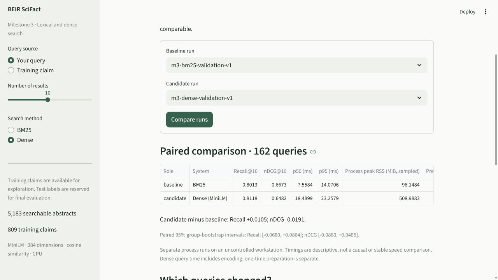

# BM25 versus MiniLM dense retrieval: measured validation results

Executed **7 November 2026**, RetrievalLab 0.3.0, Windows 11, Python 3.12.14, CPU. These are **162 train-derived validation queries, not official SciFact test results**. Same corpus of 5,183 documents, frozen split, cutoff 10, metric definitions, seed 42 and environment. No fine-tuning or test-label model selection occurred.



## Quality and performance

| System | Recall@10 | nDCG@10 | p50 / p95 (ms), first run | Query-stage sampled peak RSS (MiB) |
| --- | ---: | ---: | ---: | ---: |
| BM25 | 0.801337 | 0.667302 | 7.56 / 14.07 | 96.15 |
| MiniLM dense + FAISS exact | 0.811831 | 0.648212 | 18.49 / 23.26 | 508.99 |

Dense recalled slightly more judged evidence overall, while BM25 placed evidence earlier on average. Dense had no evidence in its top 10 for 29 queries; BM25 for 28. Neither returned an empty ranking. These two summaries differ because queries can have different numbers of relevant documents and partial recall.

The paired dense-minus-BM25 Recall difference was **+0.010494**, with a 95% group-bootstrap interval **[-0.067979, +0.086353]**. The nDCG difference was **-0.019089**, interval **[-0.086260, +0.048535]**. Both intervals cross zero; these exploratory development results do not establish a clear quality winner. The bootstrap uses 1,000 seed-42 draws of the 98 validation groups, retaining query weighting and related claims together.

Dense had higher/lower/equal nDCG on **37 / 43 / 82** queries, and higher/lower/equal recall on **17 / 10 / 135**. Dense alone found judged evidence for **9** queries; BM25 alone for **10**; both missed all evidence for **19**. Their complementary errors motivate the next hybrid-fusion experiment; improvement from fusion is not yet measured or guaranteed.

The full query call was timed after one warm-up pass and across five shuffled passes: **810 measured calls per method**. Dense includes fresh query encoding, FAISS and deterministic sorting; there is no query-result cache. CPU threads are 1 for PyTorch and FAISS. RSS covers the whole process, including interpreter, frameworks, corpus and temporary allocations; sampled peaks can miss brief spikes. Query-stage CPU seconds were **6.44 BM25 / 15.34 dense**. Resources were measured by psutil, not isolated per-model allocation counters.

Preparation took **0.66 s** for BM25 and **10.40 s** for dense using verified cached document vectors, including model/library loading and FAISS construction. Original one-time corpus encoding took **465.59 s**, and its complete preparation stage **481.31 s**, with sampled peak process RSS **1,188.15 MiB**. The embedding matrix itself is only **7,961,088 bytes** (7.59 MiB); FAISS stores another vector copy. Model weights are approximately 91 MB. Cached preparation must not be presented as the cost of encoding the corpus from scratch.

## Reproduction and independent checks

Both repeated runs produced **byte-identical `queries.json` artifacts** to their corresponding first runs: rankings, scores, per-query metrics, missed IDs and query text all reproduced. Quality, intervals and paired outcomes were identical.

| System | First p50 / p95 (ms) | Reproduction p50 / p95 (ms) | Reproduction query peak RSS (MiB) |
| --- | ---: | ---: | ---: |
| BM25 | 7.56 / 14.07 | 7.40 / 13.80 | 96.31 |
| Dense | 18.49 / 23.26 | 18.65 / 23.67 | 508.09 |

Keep both measurements. Background workstation load, power/frequency and OS cache state were uncontrolled. These descriptive timings support no stable service-level or causal speed guarantee. The reference machine reported 8 physical / 16 logical CPUs and approximately 15.25 GiB usable RAM; full platform/package metadata is in each manifest. Historical milestone 2 timings used an older environment and are preserved separately rather than mixed into this comparison.

Every per-query Recall/nDCG value passed the independent `pytrec_eval` reference check (maximum error 0 for BM25 and 1.11e-16 for dense). In both dense runs, FAISS and independent full NumPy cosine search agreed on **all 162 top-10 rankings**, with no near-tie reorderings and maximum absolute score error **1.1921e-7**, below the declared 1e-6 tolerance. Independent scikit-learn cosine calculations also passed synthetic tests. The full BEIR neural API was not executed.

All four saved runs passed artifact/dataset/split verification and matched the final retrieval/evaluation source hashes. The BM25 scoring source is unchanged from milestone 2. Git revision is unavailable in this mirror; hashes and exact package snapshots provide provenance.

## Inspect two real queries

- **Dense recovers query `0`:** “0-dimensional biomaterials lack inductive properties.” BM25 missed judged document `31715818` in its top 10. Dense placed it at **rank 4**, giving nDCG **0.430677** instead of 0. The document is *New opportunities: the use of nanotechnologies to manipulate and track stem cells.* The prior BM25 inspection found no shared query tokens with this judged abstract. This is a useful vocabulary-gap example, not a claim that the model established scientific truth.
- **Dense loses query `1112`:** BM25 placed judged document `1686881` at **rank 1** (nDCG 1.0). Dense omitted it from the first 10 (nDCG 0.0), ranking an unjudged hypertension-risk study first. Inspect the complete claim and abstracts in **Validation & failures**. Broad topical similarity is insufficient to establish the specific relevance relation; an unjudged result is not a proven negative.

Choose these queries from their respective saved reports, inspect the judged abstract and compare rankings. Relevant evidence may support or refute a claim. The full corpus is searchable, but only the declared validation labels score these experiments.

## Encoder limits

Model: [`sentence-transformers/all-MiniLM-L6-v2`](https://huggingface.co/sentence-transformers/all-MiniLM-L6-v2), revision `1110a243fdf4706b3f48f1d95db1a4f5529b4d41`; 384 dimensions, mean pooling, normalized float32, CPU eager attention, batch 32, no prompts or training. Immutable settings are in `configs/dense.json`; all model asset hashes are persisted.

Of 5,183 combined titles/abstracts, **3,681 (71.0%)** exceeded 256 model tokens and were right-truncated. The longest had 1,939 tokens. No validation query was truncated (maximum 49 tokens). This substantial loss of document endings is a limitation; it does not by itself prove the cause of any individual miss. Sequence/chunking experiments would need a separately versioned validation experiment. Upstream training overlap with SciFact was not audited; no strict zero-shot generalization claim is made.

FAISS `IndexFlatIP` scans the corpus exactly. Returning all scores and sorting by score then string document ID ensures tied cutoffs are deterministic at this small scale. This is not a million-document performance design.

## Saved evidence and reproduction

First runs: `runs/m3-bm25-validation-v1/` and `runs/m3-dense-validation-v1/`. Repeats: `runs/m3-bm25-validation-reproduction/` and `runs/m3-dense-validation-reproduction/`. Each contains a manifest, exact split, complete per-query rankings/metrics, 810 raw timings and a report. Paired JSON: `comparisons/m3-bm25-vs-dense.json` and `comparisons/m3-bm25-vs-dense-reproduction.json`. Original encoding metadata: `runs/m3-dense-preparation.json`.

Split SHA-256: `091e0d820c4dac0fd0ea80a133773da72984b7890ef15a66b053c8338d8b34c6`. This is the unchanged 647-train / 162-validation split derived from official train labels. Test labels remain reserved. Grouping reduces obvious leakage; it does not prove semantic/topic independence or eliminate upstream pretrained-model exposure.

The milestone 3 ZIP includes these measured artifacts, configuration, source, tests and docs. SciFact/model files and generated embedding caches download/build separately. After setup, reproduce with a new name:

```bash
python scripts/run_milestone3.py --name student-m3-v1
```

Read [the beginner walkthrough](../MILESTONE_3.md) and [execution record](../VERIFICATION_MILESTONE_3.md) for commands, checks that actually ran and remaining limits.
