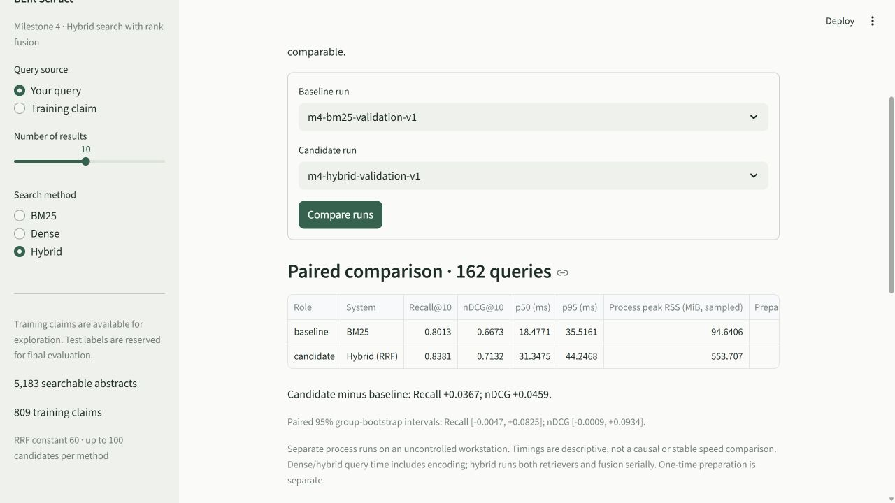

# Hybrid RRF: measured validation and candidate-depth ablation

Executed **9 November 2026**, RetrievalLab 0.4.0, Python 3.12.14, Windows CPU. These are **162 train-derived validation queries, not official SciFact test scores**. The same 5,183-document corpus, 98 validation groups, frozen split, cutoff, seed 42 and environment were used throughout. Validation had already been inspected in prior milestones; this is development evidence.

## Quality

| System | Candidates per source | Recall@10 | nDCG@10 | Queries with no judged evidence in final 10 |
| --- | ---: | ---: | ---: | ---: |
| BM25 | 10 | 0.801337 | 0.667302 | 28 |
| MiniLM dense | 10 | 0.811831 | 0.648212 | 29 |
| Hybrid RRF, primary | 100 | 0.838066 | 0.713230 | 24 |
| Hybrid RRF, declared depth ablation | 10 | 0.866358 | 0.729131 | 19 |

Both hybrid settings use equal contributions and rank constant 60. The primary depth 100 and the single depth-10 ablation were declared before milestone 4 measurements. Both are retained; depth 100 remains the declared main/default configuration rather than silently replacing it with the highest validation point score. No rank-constant sweep, neural training or test-label model selection occurred. No system returned an empty ranking.

The fixed primary hybrid improved point scores against both standalone systems. Depth 10 scored higher still, despite fewer candidates. Larger candidate pools improved coverage but also changed consensus and ordering; more candidates did not guarantee better final top-10 quality.

## Paired uncertainty, not just point scores

Differences below are **primary depth-100 hybrid minus the named baseline**. Intervals use 1,000 seeded whole-group bootstrap draws, with query weighting preserved.

| Baseline | Recall difference | 95% interval | nDCG difference | 95% interval |
| --- | ---: | --- | ---: | --- |
| BM25 | +0.036728 | [-0.004703, +0.082510] | +0.045928 | [-0.000934, +0.093357] |
| Dense | +0.026235 | [-0.034386, +0.081732] | +0.065017 | [+0.015977, +0.108476] |
| Hybrid depth 10 | -0.028292 | [-0.078234, +0.010870] | -0.015901 | [-0.046042, +0.007714] |

Only the primary hybrid's nDCG interval versus dense is wholly above zero. Both intervals versus BM25 cross zero, as do the primary-versus-depth-10 intervals. Do not turn these exploratory development comparisons into a universal superiority or untouched-test claim. They are multiple comparisons on a small, previously inspected partition; no multiplicity adjustment is claimed.

Primary hybrid had higher/lower/equal nDCG on **44 / 17 / 101** queries versus BM25, and **49 / 19 / 94** versus dense. It found some evidence on **6** queries BM25 missed but lost all evidence on **2** that BM25 retrieved; corresponding counts versus dense were **9 recovered / 4 lost**. Mean improvements coexist with individual regressions.

## Candidate recall explains a different stage

| Hybrid depth | BM25 candidate recall | Dense candidate recall | Union candidate recall | Mean union size | Queries with evidence absent from union | Queries with candidate evidence below fused top 10 |
| --- | ---: | ---: | ---: | ---: | ---: | ---: |
| 100 | 0.918519 | 0.944444 | 0.987654 | 170.51 | 2 | 29 |
| 10 | 0.801337 | 0.811831 | 0.873560 | 16.56 | 23 | 4 |

Candidate recall is a coverage upper bound, **not Recall@10**. At depth 100, relevant evidence was usually available before fusion but some was ordered below rank 10. At depth 10, less evidence entered the union, yet the restricted consensus produced better final point scores. The counts concern at least one missing/dropped positive; queries with several positives can have partial recall and can appear in both categories. They are not disjoint counts of complete failures.

Candidate diagnostics run in a separate untimed pass. Source lists are truncated before diagnostics and self IDs are removed consistently; relevance labels never enter retrieval or fusion. Unjudged documents are not proven negatives. `load_report()` rebuilds RRF contributions/rankings from saved source IDs and rechecks candidate summaries before showing these values.

## Measured latency and process resources

Each method used one warm-up pass and **five seeded shuffled passes, 810 live timed calls**. Hybrid executes both components serially at its configured depth, including fresh query encoding, then fuses/sorts/builds its trace. Document encoding/model/index preparation, labels/metrics, post-measurement diagnostics, UI and reporting are excluded from the query timer.

| System | First p50 / p95 (ms) | Repeat p50 / p95 (ms) | First query-stage sampled peak RSS (MiB) | First query-stage CPU seconds | Cached preparation (s) |
| --- | ---: | ---: | ---: | ---: | ---: |
| BM25 | 18.48 / 35.52 | 10.14 / 19.75 | 94.64 | 15.25 | 0.93 |
| Dense | 20.67 / 33.59 | 21.62 / 28.38 | 505.36 | 17.86 | 13.42 |
| Hybrid depth 100 | 31.35 / 44.25 | 32.68 / 46.53 | 553.71 | 25.63 | 12.69 |
| Hybrid depth 10 | 36.09 / 64.59 | 32.49 / 47.14 | 552.76 | 31.19 | 13.46 |

RSS is sampled whole-process resident memory, including interpreter, framework, corpus, indexes and observer allocations; it is not isolated index/model RAM and may miss short peaks. CPU seconds include runner/sampler work. The PyTorch and FAISS thread settings remain one; the machine reported 8 physical / 16 logical CPUs and approximately 15.25 GiB usable RAM. Full platform/package snapshots are in each manifest.

Workstation background load, power/frequency and OS cache state were uncontrolled. The large BM25 timing variation and slower first depth-10 run demonstrate why timing cannot be inferred from candidate count or selected from the fastest attempt. The smaller list reduces fusion work theoretically; these measurements do **not** establish a total-search speedup for depth 10. Separate-process timings need not add exactly to the hybrid's timing. All first/repeated timings are preserved, and historical milestone 3 timing is not mixed into this table.

Every dense/hybrid preparation reused the verified milestone 3 document cache. No corpus re-encoding occurred. Cached preparation includes fresh framework/model loading and index construction; hybrid also builds BM25. The original 7,961,088-byte embedding matrix and its earlier 465.59-second corpus encoding cost remain recorded. The document vectors' small size does not represent total model-process memory.

## Concrete success and regression

**Query `165`: agreement improves order.** Judged document `5824985`, *Bariatric Surgery in the United Kingdom: A Cohort Study of Weight Loss and Clinical Outcomes in Routine Clinical Care*, was rank **3 in BM25 and 3 in dense**. The primary hybrid ranked it **1**, improving nDCG from 0.5 in either child to 1.0. Its contribution is `1/63 + 1/63 = 0.031746`. This concerns relevance to the dataset claim; retrieval does not establish whether the claim is true.

**Query `0`: fusion loses dense evidence.** For “0-dimensional biomaterials lack inductive properties,” judged document `31715818` was dense rank **4** and absent from BM25's candidate list. It was present in the depth-100 union but fell to fused rank **17**, outside evaluation's top 10. Dense nDCG was 0.430677; the primary hybrid and BM25 had 0. The primary hybrid's top result had BM25 rank 2 and dense rank 24, receiving two contributions that exceeded this single-source document's contribution. The saved source lists allow the full fused rank to be reconstructed; the 162-query scoring artifacts were not modified for this inspection.

This is a fusion loss, not a candidate miss. The dashboard's **Explain fusion and candidate misses** view lists `31715818` as present in candidates but dropped below the final cutoff, and **Missed judged evidence** provides its abstract. A future reranker could investigate better ordering within a retained pool; it cannot recover a document omitted by candidate generation.

## Reproduction and independent validation

`scripts/run_milestone4.py --name m4 --repeat --depth-ablation 10` actually completed. All **eight** first/reproduction runs passed saved-report data/split/artifact validation and matched the final retrieval/evaluation source hashes. Every method's complete `queries.json` reproduced **byte for byte**, including scores, source candidate lists, fusion contributions and diagnostic fields where applicable. All paired deltas and bootstrap intervals also reproduced.

All per-query metrics passed `pytrec_eval`, with maximum absolute error at most **2.22e-16**. Every dense check matched NumPy's exact ranking on **all 162 queries**, with maximum score error **1.1921e-7**, no near-tie reorderings and tolerance 1e-6. Hybrid checked its actual candidate depth (100 or 10), not only its final top 10. Pure RRF also passed independent exact-rational unit checks. The full BEIR neural API was not executed.

The BM25, `dense.py`, encoder and vector-search source hashes match milestone 3, and all eight environment snapshots match each other. Original baseline quality reproduced exactly. Git revision is unavailable in this project mirror; data/config/model/package/source fingerprints provide provenance.

## Files and limits

Settings are in `runs/m4-configs/`. Primary folders are `runs/m4-{bm25,dense,hybrid}-validation-v1/`; the ablation is `runs/m4-hybrid-depth10-validation-v1/`. Repeats replace `v1` with `reproduction`. Each contains `manifest.json`, `split.json`, full `queries.json`, `timings.csv` and `report.md`. Six paired comparisons are `comparisons/m4-*-vs-hybrid-{v1,reproduction}.json`. The script's actual stdout is saved as `runs/m4-experiments.log`.

Split SHA-256: `091e0d820c4dac0fd0ea80a133773da72984b7890ef15a66b053c8338d8b34c6`. The frozen partition derives from official training labels; official test labels remain reserved. Grouping reduces shared-evidence/lexical leakage but does not prove semantic/topic independence. Model upstream pretraining overlap is unaudited. The existing 256-token model limit still truncates 3,681 of 5,183 combined title/abstract inputs, potentially omitting useful endings. No gradients or reranker training are involved.

RRF follows the [original reciprocal-rank-fusion formula](https://cormack.uwaterloo.ca/cormacksigir09-rrf.pdf) over truncated lists. Returning/sorting all dense scores remains an exact small-corpus design, not a million-document deployment benchmark. These observations do not establish production service guarantees, causal speed differences, isolated model memory, or official test performance.

Reproduce with a new experiment name using [the milestone 4 walkthrough](../MILESTONE_4.md). See [the execution record](../VERIFICATION_MILESTONE_4.md) for tests, browser checks and tasks not executed. The portable milestone 4 ZIP includes source, tests, guides and the actual measured artifacts; dataset/model files and generated embeddings remain separate.
