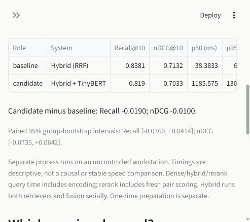

# Pretrained TinyBERT reranking: measured validation tradeoffs

Executed **9 November 2026**, RetrievalLab 0.5.0, Windows CPU, Python 3.12.14. These are **162 train-derived validation queries, not official SciFact test results**. The model/depth/profile were fixed before these results. All systems use the same data, split, metric definitions, environment and declared timing IDs.



## Full validation quality

| System | Recall@10 | nDCG@10 | Queries with no judged evidence in final 10 |
| --- | ---: | ---: | ---: |
| BM25 | 0.801337 | 0.667302 | 28 |
| MiniLM dense | 0.811831 | 0.648212 | 29 |
| Primary hybrid RRF | 0.838066 | 0.713230 | 24 |
| Hybrid top 50 + TinyBERT | 0.819033 | 0.703273 | 26 |

The fixed small pretrained reranker did **not** improve the hybrid's overall point scores, despite improving some individual queries. It also adds substantial CPU query time. This is a negative result for this particular configuration, retained as measured. There is no assumption that another neural stage must win, and the model was not replaced after viewing validation scores. No system returned an empty ranking.

The scorer is [`cross-encoder/ms-marco-TinyBERT-L2-v2`](https://huggingface.co/cross-encoder/ms-marco-TinyBERT-L2-v2), revision `81d1926f67cb8eee2c2be17ca9f793c7c3bd20cc`. It jointly scores query/title/abstract pairs using a 512-token budget, longest-first truncation, raw logits, float32 CPU eager execution, batch 16, one thread and seed 42. It reorders the actual top 50 from the unchanged primary hybrid (RRF constant 60; 100 candidates per child). No gradients, fine-tuning, model sweep or test-label selection occurred.

Its upstream task is MS MARCO passage ranking. Domain fit, compact model capacity, candidate omissions and truncation are plausible investigation directions; this experiment does not isolate the cause of the observed regression. The joint model, its training task and its longer input budget differ from the retrieval encoder, so the comparison is not an architecture-only causal test. Upstream exposure to SciFact has not been audited.

## Paired uncertainty

Differences are **reranker minus baseline**, using 1,000 seed-42 whole-group bootstrap draws over the 98 validation groups, retaining query weighting.

| Baseline | Recall difference | 95% interval | nDCG difference | 95% interval |
| --- | ---: | --- | ---: | --- |
| BM25 | +0.017695 | [-0.028923, +0.070294] | +0.035971 | [-0.016888, +0.096065] |
| Dense | +0.007202 | [-0.057820, +0.076815] | +0.055061 | [-0.012512, +0.120382] |
| Hybrid | -0.019033 | [-0.075953, +0.041415] | -0.009957 | [-0.073523, +0.064224] |

Every interval crosses zero. This small, previously inspected development partition does not establish a reliable quality winner or an untouched-test generalization claim. In particular, the negative point difference versus hybrid is not proof of a population-wide degradation. Exploratory comparisons are not adjusted for multiple testing.

Against hybrid, reranking produced higher/lower/equal nDCG on **24 / 38 / 100** queries, and higher/lower/equal recall on **5 / 11 / 146**. It retrieved some evidence for **5** queries hybrid missed, but lost all evidence for **7** where hybrid retrieved some. Improvements and regressions are both retained.

## Candidate ceilings and truncation

The actual top-50 rerank input has macro recall **0.946296**, below the larger hybrid source union's historical **0.987654** coverage. The network never scores a document outside those 50. Evidence was outside the rerank input on **10 queries**; on **25 queries**, at least one judged relevant input document was still below the final top-10 cutoff. These are counts of at least one missing positive, can involve partial recall, and are not disjoint complete-failure counts.

All **8,100** quality-evaluation pairs were scored (50 × 162). **1,069 pairs (13.20%)** exceeded the 512-token joint limit; the longest untruncated pair had **1,968 tokens**, including special tokens. This counts the full quality pass, not just the timing sample. Token-length diagnostics run outside the timing stage. Displaying full abstracts in the dashboard does not mean all tokens entered the model.

The retrieval encoder still uses its previous 256-token title/abstract budget, which truncated 3,681 of 5,183 corpus inputs during the original document-vector build. Both retrieval truncation and joint-input truncation remain limitations. Candidate recall is a ceiling on recall from this pool, not the reranker's achieved Recall@10.

## Timing scope changed explicitly for this CPU experiment

Quality covers **all 162 queries**. Timing uses the same **32 query IDs** sampled uniformly with seed 42, without inspecting relevance labels to choose fast/easy cases. A separate full-quality pass precedes one selected-query warm-up and five shuffled measured passes: **160 live calls per method**. All exact IDs and raw calls are saved and checked. This is a descriptive sample, not a distribution over every validation query or a service-level guarantee.

| System | First p50 / p95 (ms) | First query-stage sampled peak RSS (MiB) | First query-stage CPU seconds | Cached preparation (s) |
| --- | ---: | ---: | ---: | ---: |
| BM25 | 7.72 / 13.75 | 94.71 | 1.25 | 0.68 |
| Dense | 18.29 / 23.62 | 503.93 | 3.03 | 10.73 |
| Hybrid | 38.38 / 65.38 | 550.02 | 6.41 | 17.77 |
| Hybrid + TinyBERT | 1,185.57 / 1,303.43 | 829.92 | 179.80 | 18.36 |

The neural timer includes real hybrid retrieval, fresh dense query encoding, joint inference over every selected pair, sorting and trace construction. There is no query/pair-score cache. Loading models/indexes, full-quality/diagnostic work, labels/metrics, token statistics, UI and reports are outside the query timer. Retained quality traces do not bypass timed inference. No document re-encoding is required; model/cache loading and index construction are in the separate preparation stage.

RSS is sampled whole-process resident RAM, including both neural models, interpreter, corpus/indexes, tensors and observer allocations. It is not isolated TinyBERT memory and may miss short peaks. CPU seconds include runner/sampler overhead; one-core-equivalent utilization can exceed 100%. No GPU or energy measurements were made.

Workstation load, CPU power state and OS caches are uncontrolled. Historical milestone 4 used 810 calls across every validation query; its timing numbers are preserved separately and must not be mixed into this profile. The same tiny model's advertised GPU throughput is not a laptop CPU result. The added stage costs about a second per query in this declared sample; this fixed baseline offers no measured point-score gain over hybrid in exchange.

| System | First p50 / p95 (ms) | Reproduction p50 / p95 (ms) | Reproduction sampled query RSS peak (MiB) |
| --- | ---: | ---: | ---: |
| BM25 | 7.72 / 13.75 | 6.80 / 12.03 | 94.79 |
| Dense | 18.29 / 23.62 | 18.82 / 24.14 | 504.35 |
| Hybrid | 38.38 / 65.38 | 29.78 / 38.29 | 551.72 |
| Hybrid + TinyBERT | 1,185.57 / 1,303.43 | 732.47 / 1,277.38 | 845.74 |

Retain both runs. The reranker's median varied from about 0.73 to 1.19 seconds despite identical quality artifacts; selecting only the faster number would hide this variability.

## Concrete improvement and regression

**Query `618`: evidence recovered.** Judged document `6836086`, *Identification of a Multicomponent Complex Required for Outer Membrane Biogenesis in Escherichia coli*, moved from hybrid rank **16** to reranked rank **1**, changing nDCG from 0 to 1. Its raw logit was **-4.501628**. Negative logits can still be highest among a query's candidates; they are not probability thresholds. The query concerns OmpF membrane evidence; inspect the saved claim and abstract rather than treating the relevance label as scientific truth.


**Query `606`: evidence demoted.** Judged document `712078`, *Pharmacological correction of a defect in PPARγ signaling ameliorates disease severity in Cftr-deficient mice*, moved from hybrid rank **1** to reranked rank **8**. Recall stayed 1, while nDCG fell from 1 to **0.315465**. This illustrates why recall and rank-sensitive quality can move differently.

**Query `0`: available but still missed.** Document `31715818`, previously fused at rank 17, was inside the 50-document input. It remained outside the reranked top 10. This is an ordering failure rather than a candidate omission; a pretrained neural stage did not automatically resolve the milestone 4 failure.

The dashboard exposes each input/output rank and raw logit, plus omitted and lost judged evidence. It does not fabricate a natural-language explanation of why a neural score was assigned. Relevant abstracts can support or refute a claim; unjudged is not proven irrelevant.

## Saved evidence and reproduction commands

The actual `--name m5 --repeat` script completed all **eight** runs and **six** comparisons. Each method reproduced its entire `queries.json` byte for byte, including neural logits, candidate/source traces and token diagnostics where applicable. All paired differences and bootstrap intervals also matched. Every run passed saved-report verification, reference metric checks and current retrieval/evaluation source hashes; every environment snapshot and the 32 timing IDs matched. BM25, hybrid, dense, encoder and vector implementation hashes remained unchanged from milestone 4. Git metadata is unavailable in this mirror, so explicit fingerprints provide provenance.

Settings: `runs/m5-configs/`. First runs: `runs/m5-{bm25,dense,hybrid,rerank}-validation-v1/`; repeats use `reproduction` in place of `v1`. Each saves the exact split, full-quality rankings, selected-query timing calls, resource/provenance manifest and Markdown report. Neural query artifacts include all 50 input scores, original/final ranks, source fusion trace and input-token statistics. Comparisons: `comparisons/m5-{bm25,dense,hybrid}-vs-rerank-{v1,reproduction}.json`.

Split SHA-256: `091e0d820c4dac0fd0ea80a133773da72984b7890ef15a66b053c8338d8b34c6`. Official test labels remain reserved. Grouping reduces obvious shared-evidence/wording leakage but does not prove semantic or topic independence. Validation has already informed development and error analysis; no untouched-validation claim is made.

After setup, choose a new name:

```bash
python scripts/run_milestone5.py --name student-m5 --repeat
```

The script snapshots matching component settings and the timing profile, verifies/downloads pinned assets, prepares/reuses vectors, executes all systems sequentially in fresh processes, and makes paired comparisons. For the older all-query timing profile, use a separate config with `latency_query_limit: null` and rerun every baseline; do not mix profiles.

See [the beginner guide](../MILESTONE_5.md) and [execution record](../VERIFICATION_MILESTONE_5.md) for full setup, tests, limits and actual reproduction/browser outcomes. The source artifact includes measured records and excludes dataset/model binaries, document caches and virtual environments.
